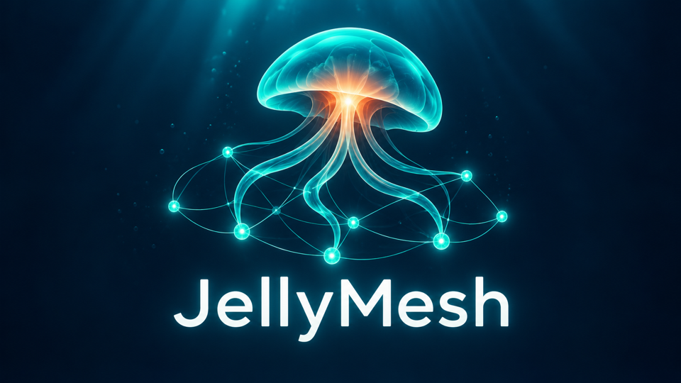

<p align="center"></p>

# JellyMesh

JellyMesh is a Jellyfin plugin that federates Jellyfin servers. Films and series from other servers appear in your existing libraries, next to your own, and play through your server. Your users only ever connect to your server.

**Status: pre-release.** It runs on Jellyfin 12.4 and has been tested against real 12.4 servers with jellyfin-web, Android and TV clients, and QSV. See [Limits](#limits).

## What it does

- Reads the film and series libraries you choose on other Jellyfin servers. Those servers can be stock Jellyfin.
- Removes duplicates. A local copy always wins. Between remote copies the best quality wins, compared by resolution, then HDR, video bitrate and codec, with bitrates within 5% counted as a tie. Losing copies stay as backup sources.
- Lets an admin merge films it can't match safely, as described in [Merging duplicates by hand](#merging-duplicates-by-hand).
- Completes series per episode: episodes you lack arrive from remotes inside your own series.
- Writes a `.strm`, a `.nfo` and local images for each title into a federated folder you choose, which you then link to your libraries.
- At playback, sends the real client's device profile to the remote, which decides between direct play and transcode and does any transcoding on its own hardware. Your server proxies the stream.
- Falls back when a remote cannot serve, as described in [Stream limit and fallback](#stream-limit-and-fallback).
- Keeps watch state on your server.
- Shows its page in the display language set in Jellyfin. English and Italian are available, and any other language shows English.

## What it doesn't do

- It does not copy media files. Only images are stored locally, and playback needs the remote to be reachable.
- It does not handle anything but films and series.
- It does not change your libraries. It writes only inside the federated folder, and you add that folder to your libraries by hand.
- It does not sync watch state to other servers.
- It does not set up Tailscale, and it cannot tell whether a URL is on your tailnet. Using only tailnet URLs is up to you.
- It does not use API keys, and it refuses an administrator account on a remote.
- It does not import items that are themselves federated on a remote, so servers can't loop.

## Roles

Both roles are active on every server with the plugin.

**Consumer.** Reads the catalogs of remote servers, merges them with your own, and plays their titles. It works against stock Jellyfin through the official API, polling for changes every 15 minutes by default, with a full reconciliation each night at 03:00.

**Provider.** Shares chosen libraries with another JellyMesh server. For each connected server you pick a dedicated local user, the libraries it can read and how many streams it can hold at once. On top of what a stock remote offers, the other server gets a change feed instead of polling, and titles that are themselves federated here are left out. Read [Trust between servers](#trust-between-servers) before you rely on these limits.

## Requirements

- Jellyfin 12.x. The manifest allows any server from 12.0, but only 12.4 has been tested, and the plugin is compiled against the 12.4 packages.
- A tailnet between your servers. Tailscale is managed outside the plugin.
- `EnableAutomaticSeriesGrouping` on in the series library you link the federated `Serie` path to, so that a local series and its remote episodes merge. In the Dashboard it is called "Automatically merge series that are spread across multiple folders". The plugin page warns if it is off and does not change it for you.
- A dedicated non-admin user on each remote.

## Install

### From a catalog

Add this plugin repository in the Dashboard, install JellyMesh from the plugin catalog, and restart Jellyfin:

```
https://raw.githubusercontent.com/antorne99/JellyMesh/main/manifest.json
```

### By hand

Download `jellymesh_<version>.zip` from a [release](https://github.com/antorne99/JellyMesh/releases) and compare it with the `.sha256` file next to it. Unpack the zip into a folder in Jellyfin's `plugins` folder, keeping `meta.json`, and restart Jellyfin. For the Docker image that folder is:

```
/config/plugins/JellyMesh_0.3.0.0/
```

You can also build the plugin and install it into a running Jellyfin container. This needs Docker and `jq`, builds in the .NET SDK image and restarts the container:

```sh
tests/Integration/scripts/install-plugin.sh <container>
```

## Docker Compose

An example, with the federated folder mounted:

```yaml
services:
  jellyfin:
    image: jellyfin/jellyfin:12.4
    environment:
      JELLYMESH_FEDERATED_ROOT: /federata # optional, see Setup
    volumes:
      - ./config:/config
      - ./cache:/cache
      - /your/media:/media:ro
      - /your/federated:/federata
```

## The credential key

Remote credentials are encrypted before they are saved, with a key that JellyMesh makes by itself at its first start: a random file named `credential.key` in its data folder. In the Docker image that is `/config/plugins/Jellyfin.Plugin.JellyMesh/`. On Linux and macOS only its owner can read it. On Windows it has the permissions of that folder. There is nothing to set.

**Back up the key file, separately from the Jellyfin config.** Without it the saved passwords can't be decrypted.

If the file is lost or replaced, JellyMesh suspends sync and remote playback and marks each server whose password no longer decrypts. Enter the login of each marked server again on its card, and the federation works again. Titles already synced stay in your libraries meanwhile, but won't play. If JellyMesh cannot keep the file at all, for example because its data folder is read-only, it saves and uses no credentials and shows a warning on its page.

**Upgrading from 0.3.** Earlier versions read the key from `JELLYMESH_SECRET_KEY`. At the first start of the new version with the variable still set, JellyMesh moves the saved passwords to the key file, once. After that the variable is no longer used, and the plugin page says you can remove it. If you remove it before upgrading, enter the login of each server again.

## Setup

All of this is on the plugin page, under Dashboard > Plugins > JellyMesh, unless it says otherwise.

### Connect a stock remote

1. On the remote, create a dedicated non-admin user that can see the libraries you want. Leave its transcoding permission on, so that the remote can transcode for you. Use it for one server only.
2. On your server, make the federated folder writable by Jellyfin. In the Compose example above that is `/federata`.
3. Under **Settings**, enter the path in **Federated folder** and save. It must be an absolute path, and not the filesystem root. If `JELLYMESH_FEDERATED_ROOT` is set, skip this step: at every start the plugin uses that path, and the field is read-only. A value that isn't usable is ignored with a warning in the log. If you remove the variable, the last path stays and the field can be edited again.
4. Under **Add a server**, enter a name, the tailnet URL of the remote, and the dedicated user and password, then choose **Connect and choose libraries**. The remote must be online, and an administrator account is refused.
5. The server's card opens with the libraries read from it. Tick what to import and choose **Save libraries**. Nothing is imported until you do. To change the choice later, choose **Libraries** on the card.
6. Under **Catalog**, choose **Sync now**. This also creates the `Film` and `Serie` subfolders.
7. In the Dashboard, add those two paths to your libraries by hand: `<federated folder>/Film` to a film library and `<federated folder>/Serie` to a series library. The plugin page shows the exact paths, and warns until they are linked.

After a sync that changes anything, JellyMesh asks Jellyfin to scan the libraries, so titles appear once that scan ends.

To stop reading a server, choose **Remove** on its card. Titles found only there leave your libraries right away, with their images. Titles also on another server stay and play from it. Nothing changes on the remote or in your local files. Only a removal from this page deletes titles: if a server goes missing from the settings in any other way, such as a reset settings file, its titles stay in your libraries, cannot play, and the plugin page warns you. Restore the settings or add the server again to bring them back.

### Connect a JellyMesh remote

The other server must let you in first, or it looks like a stock remote and you get none of the extras.

1. On the other server, create a dedicated non-admin user for your server.
2. On the other server's plugin page, under **Connected JellyMesh servers**, choose that user, tick the libraries to share, set the stream limit and choose **Connect**.
3. On your server, follow the steps for a stock remote with that user. Mode shows `JellyMesh` under **Remote servers**.

If you connect both ways, each server needs its own dedicated user on the other.

### Settings

| Setting | Default | Range |
|---|---|---|
| Sync interval | 900 s | At least 300 s |
| Nightly reconciliation time | 03:00 | |
| Protect metadata | On | |
| Close the transcode of an expired stream | On | |
| Wait for a remote to answer | 10 s | 3 to 60 |
| Wait for each step of opening a stream | 15 s | 5 to 60 |
| Close an idle remote transcode after | 90 s | 30 to 109 |
| Keep paused sessions | 24 h | 1 to 168 |
| Remember the transcoding rights of a remote | 5 min | 1 to 60 |

**Protect metadata** locks federated items, so metadata fetchers and "Replace all metadata" leave them alone. When off, `.nfo` files hold less, fetchers complete the rest, and titles without provider IDs can be matched to the wrong film.

**Close the transcode of an expired stream** is for the servers connected to yours. When a stream has no activity for 2 minutes its slot is freed, and this closes its transcode at that moment. When off, the slot is still freed and Jellyfin's own timer closes the transcode. It applies from the next expiry, without a restart. A dropped connection closes the transcode either way.

## Merging duplicates by hand

Films that JellyMesh cannot safely match, such as copies with contradicting provider IDs or the same title and year with nothing to confirm them, stay separate and are listed in the **Duplicate films** section of the plugin page. An admin can select copies and choose **Merge selected**: the best quality wins, the others stay as backups, a local copy still wins, and watch state moves to the title that stays. The choice survives restarts and syncs.

**Undo merge** separates the copies again. The title that stayed keeps all the watch state. A separated copy usually gets back what it had before the merge, but it can start with no watch state, for instance two copies with the same title and no provider IDs.

This works for films only, not series. Two local films can't be merged, so such cases aren't listed. Merges belong to one server and don't travel to other JellyMesh servers.

## Stream limit and fallback

The stream limit exists only between JellyMesh servers, because a stock remote can't report one. It counts the streams a connected server holds on the provider, including a local transcode of that provider's file, since that reads the file from the provider too.

A stream gives its slot back as soon as it ends, fails or is closed. If its connection drops, or the provider fails it with a server error, and nothing else of that stream is running, the slot stays for 5 seconds, so that a seek or a retry keeps it, and then it's free and its transcode is closed, so that the limit also holds on your hardware. If the stream comes back later it takes a free slot and the transcode restarts from there, and if none is free the client gets the 503 and the limit message below, as a new playback does. The provider may have sent everything already and not see a client go, so the server playing the title tells it when a client drops its connection and no new request arrives within those 5 seconds, which ends in the same way. A stock remote gets no such call. A paused HLS stream frees it in under 2 minutes. A server that vanishes with its connection left open is released after 2 minutes without activity, and its transcode is closed then too, unless **Close the transcode of an expired stream** is off. Disconnecting a server frees all its slots at once and ends everything it is playing, including transcodes. Taking a library away from it frees only the slots of what it can no longer reach and ends those streams, including transcodes, while what is still shared with it, from any library, keeps playing and stays counted. Lowering its limit ends at once what no longer fits, including transcodes: first streams that are still opening, then the most recently opened, so the oldest keep playing and stay counted. A limit still at or above what is running ends nothing. Any other change, such as a higher limit or an added library, frees nothing and leaves running streams alone.

When a title is played, JellyMesh tries in this order:

1. Each remote source, best quality first. A source at its limit, offline or unable to serve is skipped.
2. A local transcode on your server, reading the file from a source that answered and has a free stream slot. It uses your server's own transcoding settings. The plugin doesn't pick any hardware.
3. A local copy of the title, if one has arrived and the user can see it.

If nothing works, the title stays visible and playback is refused with HTTP 503 and a message. An offline remote costs the wait in **Settings** before the next step.

| Message | Meaning |
|---|---|
| Server non raggiungibile | No server holding the title can be reached |
| Limite di stream raggiunto sul server di origine. Riprova più tardi. | Every source is at its stream limit |
| Riproduzione non disponibile al momento. Riprova più tardi. | A server answered, but nothing could serve the title |

## Trust between servers

> **Trust between servers.** Stream limits and library sharing hold for honest peers. They are not a security boundary against a hostile one. `/Videos/{id}/stream` is anonymous in Jellyfin, so a modified server that drops its token bypasses both. Connect only servers you trust, and use each dedicated user for one server only.

A connected server can stop only the transcodes it opened, and its requests can name only those play sessions. Between ordinary users of one server, on titles that are really on it, Jellyfin's own behaviour applies: anyone who knows a play session can stop it. JellyMesh keeps that away from the titles it federates, including their local transcodes.

Remote tokens stay on your server: they never appear in `.strm` files, in logs or in anything sent to clients, and players never see a remote's address.

**Behind a reverse proxy.** Each `.strm` points to `/JellyMesh/Play/` on `127.0.0.1` and the server's own port, so Jellyfin reads it directly and never through your proxy. That endpoint refuses any request that does not arrive on a loopback connection, or that carries proxy headers (`Forwarded`, `X-Real-IP`, `X-Forwarded-*`, `X-Original-*`). A request relayed by a proxy on the same host is therefore refused, which is intended. Keep your proxy adding `X-Forwarded-For`, as most do by default. If it adds none, a relayed request looks local and only the URL signature, the main defence anyway, stands in its way.

## Limits

- **Messages:** the three refusal messages above are fixed and in Italian only, whatever the server language. They appear for 8 seconds, and only on clients that display them. Other clients show their own error.
- **Unavailable titles:** nothing in a list marks a title as unavailable. You find out when you press play.
- **Metadata saving:** tested with Jellyfin's metadata savers off. With the NFO saver on, Jellyfin might rewrite the plugin's `.nfo` files, which hasn't been tested.
- **Bandwidth:** every stream passes through your server, and over Tailscale it may pass through a relay.
- **Matching:** a title and year alone never merge two copies. When metadata can't confirm a match, both copies stay. A copy with no IDs and no year stays alone.
- **Jellyfin versions:** tested on 12.4 only.
- **Provider restart:** a stream in progress ends when the provider restarts, and the client has to open the title again.

### Built-in limits

These protect your server and are not settings. They don't stop a dishonest peer.

| Limit | Value |
|---|---|
| Playback calls at once, per remote | 16 |
| Open streams, per remote | 32 |
| Requests at once, per playback session | 8 |
| Playback sessions, per user | 16 |
| Reads at once, per connected JellyMesh server | 8 |
| Size of a JSON answer | 32 MiB |
| Size of an image or a playlist | 16 MiB |
| One catalog read of one server | 2 GiB in total |
| Time one server may take of a sync | 4 hours |

At 16 playback sessions, the oldest unused one closes first. If all are in use, the new playback is refused. A remote that goes silent mid-stream ends at the idle time in **Settings**. If a remote refuses a call from a valid login, the connection status shows "not allowed for the dedicated user".

## Development

`tests/Integration/README.md` describes the test environment and the proof scripts. To run the unit tests, from the repository root:

```sh
docker run --rm -v "$PWD":/src -v jellymesh-nuget:/root/.nuget/packages -w /src \
  mcr.microsoft.com/dotnet/sdk:10.0 dotnet test
```

## Licence

GPLv3. See `LICENSE`.
