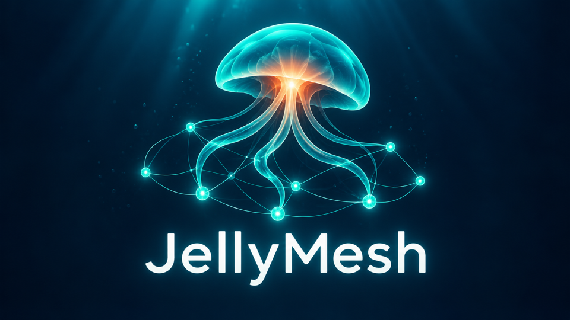

<p align="center"></p>

# JellyMesh

JellyMesh is a Jellyfin plugin that federates Jellyfin servers. Films and series from other servers appear in your existing libraries, next to your own, and play through your server. Your users only ever connect to your server.

**Status: pre-release.** It runs on Jellyfin 12.4 and has been tested against real 12.4 servers with jellyfin-web, Android and TV clients, and QSV. The versions added in 0.5 have been tested on real 12.4 servers; how the Android TV and Swiftfin apps show them has only been read from their source. What 0.6 adds has been tested on real 12.4 servers through the API and the plugin page. See [Limits](#limits).

Upgrading from 0.5 or 0.4? Read [Upgrading to 0.6](#upgrading-to-06) first: 0.6 moves the settings and state into one database, and every remote library into its own folders.

## What it does

- Reads the film and series libraries you choose on other Jellyfin servers. Those servers can be stock Jellyfin.
- Gives each library you import from a server its own folder inside a federated folder you choose, with a `Film` or `Serie` folder in it. JellyMesh makes libraries for them as the server's library mode says, or you add them to your libraries, as described in [Server folders and libraries](#server-folders-and-libraries) and [Library modes](#library-modes).
- Shows a title once in each library, with the copies of every server and your own copy as versions. A local copy is the primary version; otherwise the best quality is, compared by resolution, then HDR, video bitrate and codec, with bitrates within 5% counted as a tie. See [Versions](#versions).
- Lets an admin merge films and series it can't match safely, as described in [Merging duplicates by hand](#merging-duplicates-by-hand).
- Completes series per episode: in a series library that holds your series and the `Serie` folders of the servers, episodes you lack appear inside your own series.
- Writes a `.strm`, a `.nfo` and local images for each title, and a `season.nfo` and poster for each season, inside the federated folder. Remote YouTube trailers and intro and credits segments come along, and so do remote collections if you turn them on.
- At playback, sends the real client's device profile to the remote, which decides between direct play and transcode and does any transcoding on its own hardware. Your server proxies the stream.
- Falls back when a remote cannot serve, as described in [Stream limit and fallback](#stream-limit-and-fallback).
- Keeps watch state on your server.
- Keeps a history of its syncs and writes its events to Jellyfin's activity log, as described in [Sync history and activity log](#sync-history-and-activity-log).
- Keeps its settings and state in one database file in its data folder, with a copy each night, as described in [The plugin database](#the-plugin-database).
- Shows its page in the display language set in Jellyfin. English and Italian are available, and any other language shows English.

## What it doesn't do

- It does not copy media files. Only images are stored locally, and playback needs the remote to be reachable.
- It does not handle anything but films and series.
- It writes files only inside the federated folder. It renames and deletes only the libraries it made, and it changes the folders of a library it did not make only in these cases: a library it [adopted](#adopted-libraries), the [library of all servers](#libraries-of-all-servers), the [automatic migration](#upgrading-to-06) of the folders, and **Add them automatically** for servers you connect later. Each of these adds or removes only JellyMesh's own folders and leaves other folders, settings and permissions alone.
- It does not sync watch state to other servers.
- It does not set up the connection between your servers. A remote's URL is whatever you enter, and the plugin assumes nothing about the network in between.
- It does not use API keys, and it refuses an administrator account on a remote.
- It does not import items that are themselves federated on a remote, so servers can't loop.

## Roles

Both roles are active on every server with the plugin.

**Consumer.** Reads the catalogs of remote servers, merges them with your own, and plays their titles. It works against stock Jellyfin through the official API, polling for changes every 15 minutes by default, with a full reconciliation each night at 03:00.

**Provider.** Shares chosen libraries with another JellyMesh server. For each connected server you pick a dedicated local user, the libraries it can read and how many streams it can hold at once. On top of what a stock remote offers, the other server gets a change feed instead of polling, and titles that are themselves federated here are left out. A library that holds only federated folders, such as a library JellyMesh made for a server, is never offered. Read [Trust between servers](#trust-between-servers) before you rely on these limits.

## Requirements

- Jellyfin 12.1 or a later 12.x. The plugin is compiled against the 12.1 packages and the manifest allows any server from 12.1. It has been tested on 12.4; on 12.1 it has only been checked to start and open its database.
- Each remote reachable from your server at the URL you enter.
- `EnableAutomaticSeriesGrouping` on in every series library that holds a server's `Serie` folder, so that a local series, its remote episodes and the same series from other servers merge. In the Dashboard it is called "Automatically merge series that are spread across multiple folders". The plugin page warns if it is off and does not change it for you. The libraries JellyMesh makes are created with it on.
- A dedicated non-admin user on each remote.

## Install

### From a catalog

Add this plugin repository in the Dashboard, install JellyMesh from the plugin catalog, and restart Jellyfin:

```
https://raw.githubusercontent.com/antorne99/JellyMesh/main/manifest.json
```

### By hand

Download `jellymesh_<version>.zip` from a [release](https://github.com/antorne99/JellyMesh/releases) and compare it with the `.sha256` file next to it. Unpack the zip into a folder in Jellyfin's `plugins` folder, keeping `meta.json`, and restart Jellyfin. For the Docker image that folder is:

```
/config/plugins/JellyMesh_<version>/
```

You can also build the plugin and install it into a running Jellyfin container. This needs Docker and `jq`, builds in the .NET SDK image and restarts the container:

```sh
tests/Integration/scripts/install-plugin.sh <container>
```

## Docker Compose

An example, with the federated folder mounted:

```yaml
services:
  jellyfin:
    image: jellyfin/jellyfin:12.4
    environment:
      JELLYMESH_FEDERATED_ROOT: /federata # optional, see Setup
    volumes:
      - ./config:/config
      - ./cache:/cache
      - /your/media:/media:ro
      - /your/federated:/federata
```

Mount the federated folder at one path only, and add its folders to your libraries with that path. JellyMesh follows symbolic links, but it cannot see bind mounts: a second mount of the same folder looks like an ordinary folder. See [Limits](#limits).

## The credential key

Remote credentials, user and password, are encrypted before they are saved in the plugin database, with a key that JellyMesh makes by itself at its first start: a random file named `credential.key` in its data folder. In the Docker image that is `/config/plugins/Jellyfin.Plugin.JellyMesh/`. On Linux and macOS only its owner can read it. On Windows it gets its own access list, which lets in only the account running Jellyfin, SYSTEM and Administrators and ignores the permissions of that folder. The access list is checked by unit tests, but applying it has not been tried on a Windows server yet. There is nothing to set.

The key never goes into the database. Someone who copies the database alone sees the name, address and ID of each server, but not its user or password. When you change a password or remove a server, its old encrypted login is cleared from the database file and its log right after the save, or at the latest at the next start or nightly copy if the log is busy then; copies of the database made before still hold it.

**Back up the key file with the rest of the plugin data folder**, as described in [Backup and moving the server](#backup-and-moving-the-server). Without it the saved passwords can't be decrypted.

If the file is lost or replaced, JellyMesh suspends sync and remote playback and marks each server whose password no longer decrypts. Enter the login of each marked server again with **Edit** on its card, and the federation works again. Titles already synced stay in your libraries meanwhile, but won't play. If JellyMesh cannot keep the file private, for example because its data folder is read-only or Windows refuses its access list, it saves and uses no credentials and shows a warning on its page.

**Changing the key.** There is no command for it. Stop Jellyfin, delete `credential.key` and start Jellyfin again: JellyMesh makes a new key, suspends sync and remote playback, and each server's card asks for its password. Enter the login of each server again with **Edit**, and the federation works again with the new key.

**Upgrading from 0.3.** Earlier versions read the key from `JELLYMESH_SECRET_KEY`. At the first start of the new version with the variable still set, JellyMesh moves the saved passwords to the key file, once. After that the variable is no longer used, and the plugin page says you can remove it. If you remove it before upgrading, enter the login of each server again.

## Backup and moving the server

Jellyfin's own backup does not include JellyMesh. To back it up, copy the whole plugin data folder, `/config/plugins/Jellyfin.Plugin.JellyMesh/` in the Docker image, with Jellyfin stopped so that the database and its log are copied together. It holds `jellymesh.db` with its `-wal` and `-shm` files, the nightly copies, `credential.key` and `strm-signing.key`.

**Keep the whole folder secret, and every copy of it.** It holds the key, and with the key anyone can decrypt the saved logins of your remotes. The nightly copies of the database hold no key: a copy alone shows the name, address and ID of each server, not its user or password.

To move JellyMesh to another server, copy the whole data folder there and keep it readable only by the account that runs Jellyfin. A database without its key file works only after you enter the login of each server again.

## The plugin database

From 0.6 JellyMesh keeps all its settings and state in `jellymesh.db`, a SQLite file in its data folder, readable only by its owner. Jellyfin no longer writes a configuration file for it: the settings are read and saved only through the plugin page and its API, and Jellyfin's `/Plugins/{id}/Configuration` answers 404.

- **Nightly copy.** Each nightly reconciliation copies the database to `jellymesh.db.backup-<date>` in the same folder, and keeps the last 2.
- **A damaged file.** JellyMesh checks the file at each start. If it is damaged, it is set aside as `jellymesh.db.damaged-<date>` and JellyMesh starts again from the last nightly copy, or empty if there is none. Whatever changed after that copy is lost: a server removed since may be back, with no titles, and a server added since may be missing. The page shows a banner with the date of the copy, and asks you to check the list of servers; choose **I checked the servers** when done. Damaged files are erased 30 days later.
- **A newer database.** A database written by a newer JellyMesh, for instance after going back to an older build, is left as it is. Sync and remote playback are suspended, and the page asks you to install that version again.
- **A database that cannot be opened**, for example because of permissions or a full disk. Sync and remote playback are suspended, titles stay visible and playing them gives an error, and the page shows the reason. Fix the cause and choose **Try again**. JellyMesh never makes a new, empty database in its place.

## Setup

All of this is on the plugin page, under Dashboard > Plugins > JellyMesh, unless it says otherwise.

### Connect a stock remote

1. On the remote, create a dedicated non-admin user that can see the libraries you want. Leave its transcoding permission on, so that the remote can transcode for you. If you want the remote's collections, let it see the remote's Collections library too: without it JellyMesh reads no collections, and reports no error. Use it for one server only.
2. On your server, make the federated folder writable by Jellyfin. In the Compose example above that is `/federata`.
3. Under **Settings**, enter the path in **Federated folder** and save. It must be an absolute path, and not the filesystem root. If `JELLYMESH_FEDERATED_ROOT` is set, skip this step: at every start the plugin uses that path, and the field is read-only. A value that isn't usable is ignored with a warning in the log. If you remove the variable, the last path stays and the field can be edited again.
4. Under **Servers**, choose **Add a server** and fill in its form: a name, the **Server URL** at which your server reaches the remote, the dedicated **User** and its **Password**, and a **Library mode**, then choose **Connect and choose libraries**. The remote must be online, and an administrator account is refused. A remote that is already configured is refused too, and the message names it. The name shows in the version list, so pick one your users will recognize. The library mode starts as the one in **Settings**; see [Library modes](#library-modes).
5. The form lists the libraries the user sees on the remote. Tick what to import and save. Nothing is imported until you do. To change the choice later, choose **Edit** on the server's card.
6. JellyMesh creates a folder for each imported library: `<federated folder>/<server id>/<remote library id>/Film` for a film library and `…/Serie` for a series library, where `<server id>` is the server's ID in JellyMesh and `<remote library id>` the library's ID on the remote. In library mode **By type** or **By remote library** it makes the libraries for them; in **None** the server's card lists the paths to add to your libraries in the Dashboard, each with a copy button. The plugin page warns until the folders are in a library.
7. Under **Catalog**, choose **Sync now**, or wait for the next sync.

After a sync that changes anything, JellyMesh asks Jellyfin to scan the libraries, so titles appear once that scan ends.

To stop reading a server, choose **Remove** on its card. Titles found only there leave your libraries right away, with their images, the server's folders and the libraries JellyMesh made for it are deleted, and the libraries it adopted lose the server's folders and stay yours. Titles also on another server stay and play from it. Its copies leave the titles merged by hand, and a merge left with one copy is undone; adding the server back does not merge them again. What plays from it stops at once. On the remote, JellyMesh ends its login if the server answers within a few seconds; otherwise its JellyMesh device stays listed there. Nothing else changes on the remote or in your local files. If you add the same remote back later, it is a new server: its folders are new, so add them to your libraries again unless its library mode or [New servers](#servers-connected-later) does it. Each user's watch state stays with the content: JellyMesh saves it in its database when you remove the server, and puts it back when the same titles appear again, from that server added back or from another one, matched as in deduplication. A saved state nobody used is forgotten after 90 days. Only a removal from this page deletes titles: if a server goes missing from the settings in any other way, such as a database started again from a nightly copy older than the server, its titles stay in your libraries, cannot play, and the plugin page warns you. Restore the settings to bring them back. Adding the server again makes it a new server, and the old titles stay until you forget the missing servers on the plugin page.

### Connect a JellyMesh remote

The other server must let you in first, or it looks like a stock remote and you get none of the extras.

1. On the other server, create a dedicated non-admin user for your server.
2. On the other server's plugin page, under **Connected JellyMesh servers**, choose that user, tick the libraries to share, set the stream limit and choose **Connect**.
3. On your server, follow the steps for a stock remote with that user. Mode shows `JellyMesh` under **Remote servers**.

If you connect both ways, each server needs its own dedicated user on the other.

Once a user is connected as a server, it can no longer use that server from an app or the web client. The login still works, but every other call gets 403: such a user can reach only what federation needs, that is the JellyMesh endpoints, playback, and images and subtitles of the shared titles. To watch the other server directly, use a separate personal account there.

### Editing a server

Each server's card has three buttons: **Edit**, **Test connection** and **Remove**. **Edit** opens the same form as **Add a server**, filled in: the name, **Server URL**, **User**, **Password**, the libraries to import and the **Library mode**. Leave **Password** empty to keep the saved one.

On save, JellyMesh first logs in to the remote with what you entered, checks that the same server answers, reads the libraries the user sees and works out what the change does. That check saves nothing. If anything follows from the change, such as a rename, libraries leaving the import, streams being stopped or a new library mode, the form lists it and asks **Save these changes?** first. Then it saves all the fields, or none of them. An error is shown on the field that caused it, and changes nothing.

- If another server answers at the URL, the save is refused: remove this server and add the other one as a new server.
- If the remote does not answer, you can still change the name and the library mode. The libraries are shown read-only, and the URL, user and password can change only while the remote answers.
- If the saved password no longer decrypts, the form asks for the user and password again, and **Edit** is where you enter them.
- A library the new user no longer sees is marked "no longer visible, will be removed", and leaves the import when you save. Its titles leave at the next sync.
- A new user ends the streams of the server and the old user's login on the remote within a few seconds.
- A changed URL, user or set of libraries starts a sync of that server right after the save.

### Server folders and libraries

Each library you import from a server has its own folder, `<federated folder>/<server id>/<remote library id>/`, with a `Film` or `Serie` folder in it that holds only its titles. The folder follows the library's ID on the remote, so renaming the library there changes no folder. A file name ends with the server's name, such as `Title (2020) - Home.strm`, and that name is what the version list shows. If two servers have the same name, the one added later gets the first 8 characters of its ID after the name.

Where the `Film` and `Serie` folders go decides what your users see:

- A library that holds the folders of several servers, and your own media, shows each title once, with all those copies as versions.
- A library that holds the folders of one server shows only that server's titles.
- Put the `Serie` folders of all servers into the same libraries. A series on two servers whose `Serie` folders are in different libraries stays split, and the plugin page warns about it.
- Never add the whole federated folder, or a folder above `Film` and `Serie`, to a library. The versions of a title come apart and the server libraries empty. The plugin page warns about it.

The plugin page also tells you when a library was added over the federated folder or left it since the last sync. The next sync links the versions again.

If a library you import disappears from a server that answers normally, and stays gone for two syncs in a row, JellyMesh stops importing it, empties its folder and deletes the library it made for that library alone; from an adopted library it only takes its folders out. The page and the sync history say which libraries went. Nothing is taken away while a server is offline or answers with an error. A library that comes back with another type has a new ID, and arrives as a new library.

### Library modes

Each server has a library mode, chosen in its form. The mode decides only which libraries hold the server's folders; it moves no files.

- **By type**: JellyMesh makes one library for the films and one for the series of the server, `<server name> - Film` and `<server name> - Serie`, each with the folders of that type of every library imported from it. A library is made only for a type with at least one imported library, and one already made stays even when it empties.
- **By remote library**: JellyMesh makes one library for each library imported from the server, `<server name> - <remote library name>`, of the same type.
- **None**: JellyMesh makes no library for the server. The card lists the paths to add to your libraries in the Dashboard by hand.

If a name is taken, JellyMesh adds the first 8 characters of the server's ID; if that is taken too, the library is not made and the page says so. The libraries use your server's default metadata settings, with series merging on, and with **Automatically add to collection** on when **Write remote collections into films** is on. In **By remote library**, each library holds one server, so the versions of several servers show only in your own libraries or in the [libraries of all servers](#libraries-of-all-servers).

- JellyMesh renames and deletes only the libraries it made. A library you rename in the Dashboard, keeping its folders and type, stays JellyMesh's. If you change its folders or type, JellyMesh lets it go, the page lists it, and it is yours to keep or delete.
- Permissions stay with you. Users with access to only some libraries do not see these until you enable them for those users in Dashboard > Users.
- If one of them goes missing, **Recreate missing libraries** brings it back.
- Changing the mode in **Edit** asks first. JellyMesh makes or adopts the new libraries and waits for their scan, then deletes the libraries it made for the old mode. The folders don't change, so titles and watch state stay. Changing to **None** deletes the libraries JellyMesh made and lets the adopted ones go.
- Removing the server deletes the libraries JellyMesh made for it.
- Another library on the same folders shows the titles twice, and the page warns about it.

#### Adopted libraries

Before making a library, JellyMesh looks for one with exactly the folders it would give it and the same type. If there is one, it adopts it instead, without asking, and the page marks it "(adopted)". JellyMesh keeps the folders of an adopted library up to date as you change the libraries you import, but never renames or deletes it and never changes its permissions. When the server changes to **None**, or is removed, JellyMesh takes its own folders out and leaves the library to you.

A library that holds a folder above those folders, has another type, or holds other folders as well, is neither adopted nor joined by a new library, because a second library on the same folders would show every title twice. The page says what to change: take the extra folders out, or set the server's library mode to **None**.

### Libraries of all servers

Under **Settings**, **Libraries of all servers**, **One library per type with all servers** is off by default. When on, JellyMesh makes or adopts `Tutti i server - Film` and `Tutti i server - Serie`, which hold the folders of that type of every server, in any library mode. A server you add joins them at once, and one you remove leaves them before its titles are deleted. With no servers they stay, empty.

- You can rename them in the Dashboard: JellyMesh follows them and does not put the name back.
- In library mode **By type** or **By remote library** a folder is also in the library of its server, so its titles show in both libraries. Each is one title, with one watch state, as in Jellyfin when two libraries share a folder. A server in mode **None** is only in the libraries of all servers.
- The versions of several servers show here.
- A library of all servers you made by hand in 0.5, with exactly these folders and type, is adopted.
- Turning it off asks first, then deletes the libraries JellyMesh made and leaves the adopted ones to you, without JellyMesh's folders.

### Servers connected later

Under **Settings**, **Library mode of a server linked later** is the mode the form of **Add a server** starts with, **By type** by default. A server already added keeps its own mode, which **Edit** changes.

**New servers** decides what happens to the folders of a server you connect later. **Add them by hand** leaves them to you. **Add them automatically** adds them to every library that holds the folders of another server, except the libraries JellyMesh made or adopted for one server and the libraries of all servers; each library gets the folders of the same type, one for each library imported from the new server. It starts as **Add them automatically** after an automatic migration, and as **Add them by hand** otherwise.

### Renaming a server

Change the name in the server's **Edit** form and save. The new name shows in the version list and in the names of the libraries JellyMesh made for the server; its folders stay the same, and adopted libraries keep their names. JellyMesh renames the server's files and carries the watch state to them.

- The libraries are scanned twice before the rename is done. Until then the titles of this server may show twice among the versions.
- The libraries JellyMesh made for it are renamed too, and JellyMesh updates the users allowed or blocked on them. Each one empties and fills again, and its sort order and view start over. On Jellyfin 12.1 its place in each user's home screen order and exclusions starts over too.
- A renamed library keeps its old ID until Jellyfin restarts: until then, users who open it by that ID get an error. Restart Jellyfin when you can.
- If the rename stops halfway, the card says so and the name can't change: save the form again with the same name to finish it. **Cancel the pending rename** keeps the new name for the titles, deletes their old files at once, and loses the watch state not yet carried.

### Settings

| Setting | Default | Range |
|---|---|---|
| Sync interval | 900 s | At least 300 s |
| Nightly reconciliation time | 03:00 | |
| Protect metadata | On | |
| Close the transcode of an expired stream | On | |
| Wait for a remote to answer | 10 s | 3 to 60 |
| Wait for each step of opening a stream | 15 s | 5 to 60 |
| Close an idle remote transcode after | 90 s | 30 to 109 |
| Keep paused sessions | 24 h | 1 to 168 |
| Remember the transcoding rights of a remote | 5 min | 1 to 60 |
| Write remote collections into films | Off | |
| Library mode of a server linked later | By type | By type, By remote library, None |
| New servers: folders of a server linked later | See [Servers connected later](#servers-connected-later) | |
| One library per type with all servers | Off | |

**Protect metadata** locks federated items, so metadata fetchers and "Replace all metadata" leave them alone. When off, `.nfo` files hold less, fetchers complete the rest, and titles without provider IDs can be matched to the wrong film.

**Close the transcode of an expired stream** is for the servers connected to yours. When a stream has no activity for 2 minutes its slot is freed, and this closes its transcode at that moment. When off, the slot is still freed and Jellyfin's own timer closes the transcode. It applies from the next expiry, without a restart. A dropped connection closes the transcode either way.

**Write remote collections into films** puts the collection a film has on its server into its `.nfo`. Jellyfin groups the films only in libraries with **Automatically add to collection** turned on. The dedicated user on a stock remote must see that remote's Collections library, and a JellyMesh remote sends its collections only from 0.5. A collection with the same name as one of yours fills yours. Jellyfin adds films to collections but never takes them out, so after a collection changes on a remote, or a film leaves, remove old or empty collections by hand. Turning this off keeps the collections already made.

### Sync history and activity log

Under **Catalog**, **Sync history** lists the last 50 syncs and the last 7 nightly reconciliations: start, duration, kind and outcome, and for each server the titles read, created, updated and removed, and the errors. JellyMesh also writes to Jellyfin's activity log when a server goes offline or is reachable again, when a sync fails, when saved passwords no longer decrypt, and once for each completed sync: about 96 entries a day at the default interval. Neither shows server addresses or tokens.

## Versions

Inside a library, a title shows once. Its versions are the copies of every server, and your local copy, that the user can see; a user is never offered a version in a library they cannot open. The version list names each server copy by its server.

- **The primary version** is the same for everyone: the local copy, otherwise the best quality. It changes only when a local copy arrives or leaves, or when its server is removed.
- **The version that starts** when the client picks none is the local copy if the user can see it, otherwise the best version the user can see. A version the client picks always wins among those the user can see.
- **Watch state:** "watched" is one for the whole title, on every version and in every library. The resume position stays with the version that was played.
- **Series** don't become versions. Jellyfin merges the same series from several servers when their `Serie` folders are in the same series library, with series merging on. Episodes become versions like films, but only when they cover the same episodes: a double episode in one file on one server and two separate episodes on another stay separate.
- **JellyMesh keeps the links.** If an admin uses Jellyfin's **Split** action on a title (the "Split Media Apart" dialog; in Italian, "Dividi") or merges versions there, JellyMesh links them back at the next sync. To separate copies you merged, use **Undo merge** on the plugin page. A link lost while nothing else changed comes back at the nightly reconciliation or at the next change.

See [Limits](#limits) for what Jellyfin shows of versions in collections, "Latest" and "Continue watching".

## Merging duplicates by hand

Films and series that JellyMesh cannot safely match, such as copies with contradicting provider IDs or the same title and year with nothing to confirm them, stay separate and are listed in the **Duplicate films** and **Duplicate series** sections of the plugin page. An admin can select copies and choose **Merge selected**: the copies become versions of one title, and a local copy is still the primary version, otherwise the best quality is. A series is merged episode by episode, and each episode starts from its best copy. When two titles of the same library become one, the favourite, rating and play count move to the primary version, and "watched" is aligned; the resume position is not touched. For series this happens per episode, and the favourite and rating of the whole series don't move. The choice survives restarts and syncs.

**Undo merge** separates the copies again. The title that stayed keeps all the watch state. A separated copy usually gets back what it had before the merge, but it can start with no watch state, for instance two copies with the same title and no provider IDs. Use **Undo merge** and not Jellyfin's own split of versions, which JellyMesh undoes at the next sync.

Two local films, or two local series, can't be merged, so such cases aren't listed. Merges belong to one server and don't travel to other JellyMesh servers. Removing a server takes its copies out of the merges, and a merge left with one copy is undone. Two servers' copies of a merged series may still show as two rows in a library, because each server keeps its own series IDs.

## Upgrading to 0.6

0.6 needs Jellyfin 12.1 or later, like 0.5: upgrade Jellyfin first if you are on 12.0.

**Your data moves into the database.** At its first start, before anything else runs, 0.6 moves the plugin settings, the servers with their saved logins, the connected servers, the merges, the sync history and the other files of 0.5 or 0.4 into `jellymesh.db`, in one step. The saved logins move still encrypted, so no password has to be entered again, and a server that was asking for its password still asks. The old files then go to the folder `migrated-0.5` in the plugin data folder, readable only by its owner, and are never read again. The page says until when they are kept: they are overwritten and erased at the first nightly reconciliation 30 days after the move, if the database passed its last check. If the move fails, nothing moves, JellyMesh waits, and it tries again at the next start with a warning.

**Your folders move to one folder per remote library.** Up to 0.5 each server had one `Film` and one `Serie` folder, and in 0.4 all servers shared them. 0.6 writes the new folders next to the old ones, and the plugin page shows a banner, **Choose how to move to the folders of each remote library**. A server on 0.4 moves to the new folders in one step.

- If you chose **Migrate automatically** in 0.5, 0.6 migrates automatically without asking. If you chose to do it by hand, it stays by hand. Otherwise the banner offers **Migrate automatically** and **I'll do it by hand**, with no default.
- Until the migration ends, the old titles stay as they are and keep playing, but no new titles arrive. Until it runs, each title shows twice in the libraries JellyMesh made for a server in library mode **By type**.
- **Migrate automatically.** For each library that holds an old folder of a server, JellyMesh adds the new folders of the same type of that server, one for each library imported from it, waits for the sync and the scan, moves the watch state, takes the old folder out of the library and empties it. It touches no other folders or settings. The banner shows each step. If a step fails, the migration stops with the old folders still working, the banner shows the error and the steps left, and **Try again** resumes from that step; you can also do the steps left by hand.
- **I'll do it by hand.** The banner lists, for each library, the folders to add and the old ones to remove. Add the new folders first; after the scan JellyMesh moves the watch state and empties the old folders, and the banner asks you to **Remove the old folders from the libraries**.
- Each server gets a library mode: **By type** if its automatic libraries were on in 0.5, which keep their names, IDs and permissions and change only their folders, and **None** if they were off. Servers you add later start with **By type**, unless you change **Library mode of a server linked later**.

Watch state moves to the new titles user by user: the resume position goes to the version of the server that last played the title, otherwise to the best one; the favourite, rating and play count go to the primary version; "watched" is shared by all versions.

**Going back to 0.5 is not supported.** While `migrated-0.5` exists, that is for at least 30 days after the upgrade, you can restore 0.5 by hand:

1. Stop Jellyfin.
2. Move `Jellyfin.Plugin.JellyMesh.xml` from `migrated-0.5` back to Jellyfin's `plugins/configurations` folder, and the other files of `migrated-0.5` back to the plugin data folder.
3. Move `jellymesh.db` and its `-wal` and `-shm` files out of the plugin data folder. If they stay, a later upgrade to 0.6 starts from that database and ignores the files of 0.5.
4. Replace the plugin with 0.5 and start Jellyfin.

Everything that changed since the upgrade is lost. Going back after the folder migration has run has not been tested.

**There is no going back to 0.4** from 0.5 or 0.6. 0.5 saves its state in a format that 0.4 discards, and an older plugin would read merged series as films.

## Stream limit and fallback

The stream limit exists only between JellyMesh servers, because a stock remote can't report one. It counts the streams a connected server holds on the provider, including a local transcode of that provider's file, since that reads the file from the provider too.

A stream gives its slot back as soon as it ends, fails or is closed. If its connection drops, or the provider fails it with a server error, and nothing else of that stream is running, the slot stays for 5 seconds, so that a seek or a retry keeps it, and then it's free and its transcode is closed, so that the limit also holds on your hardware. If the stream comes back later it takes a free slot and the transcode restarts from there, and if none is free the client gets the 503 and the limit message below, as a new playback does. The provider may have sent everything already and not see a client go, so the server playing the title tells it when a client drops its connection and no new request arrives within those 5 seconds, which ends in the same way. A stock remote gets no such call. A paused HLS stream frees it in under 2 minutes. A server that vanishes with its connection left open is released after 2 minutes without activity, and its transcode is closed then too, unless **Close the transcode of an expired stream** is off. Disconnecting a server frees all its slots at once and ends everything it is playing, including transcodes. Taking a library away from it frees only the slots of what it can no longer reach and ends those streams, including transcodes, while what is still shared with it, from any library, keeps playing and stays counted. Lowering its limit ends at once what no longer fits, including transcodes: first streams that are still opening, then the most recently opened, so the oldest keep playing and stay counted. A slot ended by taking a library away or by lowering the limit stays counted until its transcode is closed, a second or two, and that stream cannot take it back. A limit still at or above what is running ends nothing. Any other change, such as a higher limit or an added library, frees nothing and leaves running streams alone.

When a title is played, the version that starts is the one the client picked, otherwise the local copy if the user can see it, otherwise the best version the user can see. If a server version can't play, JellyMesh tries in this order:

1. The sources of that version, then the other versions the user can see, best quality first. A source at its limit, offline or unable to serve is skipped.
2. A local transcode on your server, reading the file from a source that answered and has a free stream slot. It uses your server's own transcoding settings. The plugin doesn't pick any hardware.
3. A local copy of the title, if the user can see it.

If nothing works, the title stays visible and playback is refused with HTTP 503 and a message. An offline remote costs the wait in **Settings** before the next step.

If a source drops during playback, the player's next request gets an error at once, and its retry plays from another source: the one that dropped goes last for that user and title for 5 minutes. A title that drops more than 3 times within those 5 minutes is refused until they pass.

| Message | Meaning |
|---|---|
| Server non raggiungibile | No server holding the title can be reached |
| Limite di stream raggiunto sul server di origine. Riprova più tardi. | Every source is at its stream limit |
| Riproduzione non disponibile al momento. Riprova più tardi. | A server answered, but nothing could serve the title |

## Trust between servers

> **Trust between servers.** Stream limits and library sharing hold for honest peers. They are not a security boundary against a hostile one. `/Videos/{id}/stream` is anonymous in Jellyfin, so a modified server that drops its token bypasses both. Connect only servers you trust, and use each dedicated user for one server only.

A connected server can stop only the transcodes it opened, and its requests can name only those play sessions. Between ordinary users of one server, on titles that are really on it, Jellyfin's own behaviour applies: anyone who knows a play session can stop it. JellyMesh keeps that away from the titles it federates, including their local transcodes.

Remote tokens stay on your server: they never appear in `.strm` files, in logs or in anything sent to clients, and players never see a remote's address.

**Behind a reverse proxy.** Each `.strm` points to `/JellyMesh/Play/` on `127.0.0.1` and the server's own port, so Jellyfin reads it directly and never through your proxy. That endpoint refuses any request that does not arrive on a loopback connection, or that carries proxy headers (`Forwarded`, `X-Real-IP`, `X-Forwarded-*`, `X-Original-*`). A request relayed by a proxy on the same host is therefore refused, which is intended. Keep your proxy adding `X-Forwarded-For`, as most do by default. If it adds none, a relayed request looks local and only the URL signature, the main defence anyway, stands in its way.

## Limits

- **Messages:** the three refusal messages above are fixed and in Italian only, whatever the server language. They appear for 8 seconds, and only on clients that display them. Other clients show their own error.
- **Unavailable titles:** nothing in a list marks a title as unavailable. You find out when you press play.
- **Metadata saving:** tested with Jellyfin's metadata savers off. Linking versions writes no `.nfo`, even next to a local copy. With the NFO saver on, Jellyfin might rewrite the plugin's `.nfo` files, which hasn't been tested.
- **Collections and versions:** a collection holds only the primary version of a title. A user who can't see that version doesn't see the title in the collection. Playlists keep the version the user added.
- **Latest:** the card of a title in "Latest" shows its most recent version.
- **Continue watching:** a title shows only with the version that was watched.
- **Series from several servers:** they merge only in libraries that hold the `Serie` folders of all those servers. A series merged by hand may show as two rows.
- **Jellyfin's own version actions:** splitting versions apart, or merging them, in Jellyfin is undone at the next sync. Use **Undo merge** on the plugin page.
- **Renaming a library in the Dashboard on 12.1:** Jellyfin 12.1 does not update the users' library permissions. Users who had the library allowed lose it, and users who had it blocked see it. Check Dashboard > Users after renaming a library there. JellyMesh does this for you only when it renames its own libraries.
- **Same folder, other path:** JellyMesh recognizes the federated folder through symbolic links and Unicode forms of its path, but not through a bind mount, which it cannot see. Federated series and seasons reached through a second mount can be offered to other JellyMesh servers, so always add the folders with the same path. A symbolic link from an ordinary library into the federated folder lets nothing out, but a connected server may get a shorter page of titles.
- **Changes by hand:** files you change in the federated folder are put right only by the nightly reconciliation.
- **Going back:** a server that has run 0.6 goes back to 0.5 only by hand, as described in [Upgrading to 0.6](#upgrading-to-06), and one that has run 0.5 can't go back to 0.4.
- **Bandwidth:** every stream passes through your server, which reads it from the remote and sends it to the client.
- **Matching:** a title and year alone never merge two copies. When metadata can't confirm a match, both copies stay. A copy with no IDs and no year stays alone.
- **Seasons from two servers:** when two servers give different names or plots for a season of the same series, which one Jellyfin shows is effectively random, and stays the same on a given install. Each episode keeps the season name of its own server.
- **Jellyfin versions:** 12.1 is the minimum. Tested on 12.4; on 12.1 only starting the plugin and opening its database have been checked.
- **Provider restart:** a stream in progress ends when the provider restarts, and the client has to open the title again.

### Built-in limits

These protect your server and are not settings. They don't stop a dishonest peer.

| Limit | Value |
|---|---|
| Playback calls at once, per remote | 16 |
| Open streams, per remote | 32 |
| Requests at once, per playback session | 8 |
| Playback sessions, per user | 16 |
| Reads at once, per connected JellyMesh server | 8 |
| Size of a JSON answer | 32 MiB |
| Size of an image or a playlist | 16 MiB |
| One catalog read of one server | 2 GiB in total |
| Time one server may take of a sync | 4 hours |

At 16 playback sessions, the oldest unused one closes first. If all are in use, the new playback is refused. A remote that goes silent mid-stream ends at the idle time in **Settings**. If a remote refuses a call from a valid login, the connection status shows "not allowed for the dedicated user".

## Development

`tests/Integration/README.md` describes the test environment and the proof scripts. To run the unit tests, from the repository root:

```sh
docker run --rm -v "$PWD":/src -v jellymesh-nuget:/root/.nuget/packages -w /src \
  mcr.microsoft.com/dotnet/sdk:10.0 dotnet test
```

## Licence

GPLv3. See `LICENSE`.
